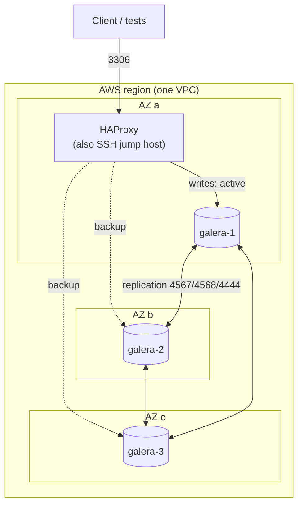
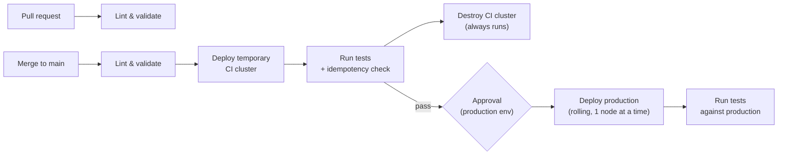

# galera-path-to-production — Design

Push-button path to production for a highly available MariaDB Galera cluster on AWS.
Terraform builds the infrastructure, Ansible roles configure it, and GitHub Actions
proves every change on a temporary production-shaped cluster before it can reach
production.

---

# Part 1 — High-Level Design (HLD)

## 1. Goals

- **Gate deployment on tests.** No change reaches production unless it passed the
  same tests on a real, temporary cluster first.
- **Push-button production deploys.** Everything up to production is automatic;
  production itself requires one approval click.
- **Highly operable result.** Survives the loss of a node or an availability zone,
  changes roll out safely, and someone else can operate it from the runbook.
- **Small and explainable.** Every file should be easy to walk through.

## 2. Non-goals (stated up front, documented as next steps)

- Redundant load balancer tier (single HAProxy for now; see Risks).
- Private subnets with a NAT gateway (avoided for cost; see Decisions).
- Backups, metrics and alerting (stretch goals).
- Application layer: this project delivers the database platform, not an app on top.

## 3. How this maps to the brief

| Brief requirement | Where it's met |
|---|---|
| Open-source codebase | MariaDB + Galera + HAProxy, deployed by this repo's Terraform and Ansible |
| Path to production, push-button or continuous | GitHub Actions: automatic through CI, manual approval for production |
| Run available tests, gate deployment | Lint + full test suite on a temporary CI cluster; failure stops the pipeline |
| Public cloud | AWS |
| Highly operable | 3 nodes across 3 AZs, quorum, health-checked failover, rolling changes, runbook |

## 4. Architecture



- **3 Galera nodes, one per AZ.** Galera needs a majority to keep accepting
  writes; with 3 nodes, any single node or AZ can fail and the cluster stays up.
- **HAProxy in active-backup mode.** All traffic goes to one node; the others take
  over only if it fails. Galera is multi-master, but writing to several nodes at
  once causes certification conflicts and deadlock retries, so one writer is safer.
- **HAProxy doubles as the SSH jump host**, so the Galera nodes never accept SSH
  from the internet.

## 5. Pipeline



- **Pull requests** get lint only, so they're fast and need no cloud access.
- **Merges to main** run the full gate. The CI cluster is built from the exact same
  Terraform and Ansible as production, just under a different name.
- **The CI cluster is always destroyed**, pass or fail, so it never lingers or costs money.
- **One test suite, used twice:** the gate in CI and the verification in production.

## 6. Environments

| Environment | Lifetime | Created by | Purpose |
|---|---|---|---|
| `ci` | Minutes, per pipeline run | Pipeline | Prove the change works before production |
| `prod` | Long-lived | Pipeline, after approval | The real cluster |

Separated by Terraform workspace: same code, separate state, separate resource names.

## 7. Key decisions and tradeoffs

| Decision | Why | Tradeoff |
|---|---|---|
| Test on a temporary real cluster instead of Docker/Molecule | Real Galera behavior, one test suite, no systemd-in-containers issues | Each run takes ~10–15 min and a few cents |
| Single HAProxy | Keeps scope achievable | Single point of failure; fix is 2 HAProxies behind an AWS NLB |
| Public subnets, no NAT gateway | NAT is the most expensive piece for a short-lived project | Nodes have public IPs; security groups allow DB and replication traffic only from inside the cluster |
| Active-backup writes | Avoids Galera certification conflicts | One node carries all traffic (fine at this scale) |
| GitHub OIDC to AWS | No long-lived access keys anywhere | Slightly more IAM setup |
| Fail-forward over rollback | Database changes rarely roll back cleanly; rolling one node at a time limits blast radius | A bad change needs a fix-forward commit |

## 8. Operability

- **Failure tolerance:** any one node or AZ can fail; HAProxy health checks move
  traffic within seconds.
- **Safe changes:** config changes roll out one node at a time, and each node must
  rejoin and resync before the next one starts. The run stops on the first failure,
  leaving the other 2 nodes serving.
- **Runbook (README):** deploy, rolling restart, replace a failed node, and full-cluster
  bootstrap recovery (start from the node with the highest `seqno` in `grastate.dat`).

## 9. Risks

| Risk | Mitigation |
|---|---|
| HAProxy is a single point of failure | Documented; next step is NLB + 2 HAProxies |
| First-time Galera bootstrap logic is error-prone | Bootstrap only when no cluster exists; idempotent checks; tested every CI run |
| CI cluster left running after a failed run | Destroy step runs on `always()`; billing alert as backstop |
| Secrets leaking | Passwords only in GitHub environment secrets; no keys in repo |

---

# Part 2 — Low-Level Design (LLD)

## 1. Repository layout

```text
galera-path-to-production/
├── terraform/
│   ├── main.tf            # VPC, subnets, security groups, instances
│   ├── variables.tf
│   ├── outputs.tf         # IPs used to build the Ansible inventory
│   ├── versions.tf        # provider pins + S3 backend
│   └── inventory.tftpl    # template rendered into ansible/inventory.ini
├── ansible/
│   ├── ansible.cfg
│   ├── site.yml           # entry point: full deploy
│   ├── verify.yml         # cluster verification (assert tasks; -e run_failover=true)
│   ├── group_vars/all.yml
│   └── roles/
│       ├── common/        # packages, time sync, base hardening
│       ├── galera/        # MariaDB + Galera install, config, bootstrap/join
│       └── haproxy/       # HAProxy install + active-backup config
├── .github/workflows/
│   ├── lint.yml           # pull requests
│   └── deploy.yml         # main: CI cluster gate -> approval -> prod
├── Makefile               # make deploy / test / destroy (local use)
└── README.md
```

## 2. Terraform

**Backend:** S3 bucket for state with S3-native locking, created once by hand.

**Resources (`main.tf`):**

- VPC `10.0.0.0/16`; three public subnets, one per AZ; internet gateway; route table.
- Security groups:

| SG | Inbound | From |
|---|---|---|
| `haproxy` | 22 | Pipeline runner IP only (added at job start, removed at end) |
| `haproxy` | 3306 | Pipeline runner IP / your IP |
| `galera` | 3306 | `haproxy` SG |
| `galera` | 4567 (tcp+udp), 4568, 4444 | `galera` SG (replication, IST, SST) |
| `galera` | 22 | `haproxy` SG (via jump host) |

- Instances: 3 × Galera, 1 × HAProxy. Ubuntu 24.04, small instance types.
  Tagged with `env` = workspace name.

**Outputs:** HAProxy public IP, Galera private IPs → rendered into
`ansible/inventory.ini` via `inventory.tftpl`.

**Variables:** `env`, `instance_type`, `ssh_public_key`, `allowed_cidr`.

## 3. Ansible

**Entry point — `site.yml`:**

```yaml
- hosts: all
  roles: [common]

- hosts: galera
  serial: 1              # one node at a time
  any_errors_fatal: true # stop the run on the first failure
  roles: [galera]

- hosts: haproxy
  roles: [haproxy]
```

**Role `galera`:**

- `tasks/main.yml` → install, configure, bootstrap-or-join, wait-for-synced.
- `templates/galera.cnf.j2` → `wsrep_cluster_address` built from inventory,
  `wsrep_node_address`, `wsrep_sst_method=mariabackup`, `binlog_format=ROW`,
  `innodb_autoinc_lock_mode=2`.
- **Bootstrap logic:** on the first node only, and only if no node reports a running
  cluster, run `galera_new_cluster`. Every other case is a normal join. Running it
  again on a healthy cluster changes nothing.
- **Wait-for-synced:** after any restart, poll `wsrep_local_state_comment` until it
  is `Synced` before Ansible moves to the next node.
- `handlers/main.yml` → restart MariaDB (respects `serial: 1`).
- `defaults/main.yml` → cluster name, SST user, timeouts.

**Role `haproxy`:**

- `templates/haproxy.cfg.j2` → frontend on 3306; backend with first Galera node
  active and the rest marked `backup`; health checks every 2s.
- Validate with `haproxy -c -f` before reload.
- Health check (MVP): MySQL-level check. Limitation: confirms the node accepts
  connections, not that it's `Synced`. Next step: a small HTTP check that
  reports Synced state.

**Secrets:** root and SST passwords come from GitHub environment secrets, passed
as extra vars at runtime. Never written to the repo.

## 4. Tests (`ansible/verify.yml`, Ansible `assert` tasks)

Verification is an Ansible playbook so the repo stays one toolchain. The gate run is
safe; the failover test is opt-in (`-e run_failover=true`) because it stops a node.

| Check | What it asserts |
|---|---|
| cluster health | `wsrep_cluster_size` = 3, `Primary`, `Synced` on every node |
| write replicates | Insert a unique token through HAProxy; read it back from each node directly |
| idempotency (pipeline step) | Second `ansible-playbook site.yml` run reports `changed=0` |
| failover (opt-in, disruptive) | Stop the active node; writes via HAProxy recover; node rejoins and resyncs |

Run: `ansible-playbook verify.yml` (gate) / `ansible-playbook verify.yml -e run_failover=true` (with failover).

## 5. Pipeline detail (`deploy.yml`)

| Job | Runs | Key steps |
|---|---|---|
| `lint` | Always | `ansible-lint`, `yamllint`, `ansible-playbook --syntax-check`, `terraform fmt -check`, `terraform validate` |
| `ci-cluster` | After `lint` | OIDC → AWS; `terraform workspace select -or-create ci`; apply; add runner IP to SG; `ansible-playbook site.yml`; run again for idempotency; `pytest` |
| `ci-teardown` | `if: always()` after `ci-cluster` | `terraform destroy` in `ci` workspace |
| `prod` | After `ci-cluster` passes; `environment: production` (approval) | Same steps in `prod` workspace, no destroy; `pytest` against production |

**AWS access:** one IAM role trusted for this repo via GitHub OIDC, scoped to
EC2/VPC and the state bucket.

## 6. Failure handling

- **Pipeline:** any failed job stops everything after it. Production is never
  reached if CI fails.
- **Rolling deploy:** `serial: 1` + `any_errors_fatal` stops at the first bad node;
  the other 2 keep serving and quorum holds.
- **Recovery:** fix forward with a new commit. Full-cluster recovery steps are in
  the runbook.

## 7. Build order (one day)

1. AWS account, billing alert, state bucket, OIDC role; repo + local tools.
2. Terraform: network + instances, applied by hand.
3. `galera` role against those instances until the cluster forms and is idempotent.
4. `haproxy` role.
5. Tests.
6. GitHub Actions: lint → CI cluster gate → approval → prod.
7. README: diagram, decisions, results, runbook, limitations.
