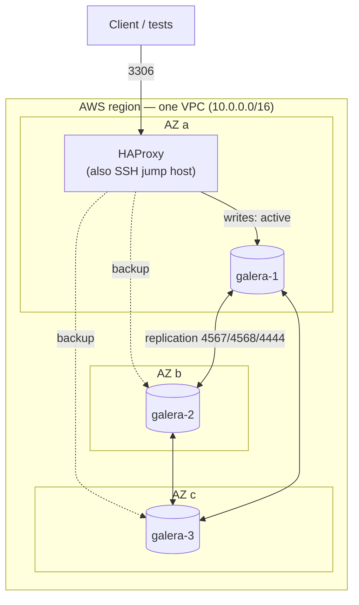
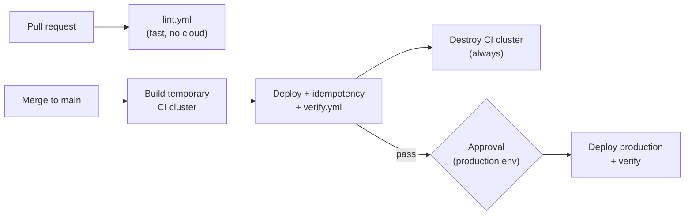

# galera-path-to-production

> Push-button, test-gated path to production for a highly available MariaDB Galera cluster on AWS — Terraform for infrastructure, Ansible for configuration, and GitHub Actions to prove every change on a real, temporary cluster before it can reach production.


No change reaches production unless it first passed the full test suite on a throwaway, production-shaped cluster. Everything up to production is automatic; production itself takes one approval click.

See [DESIGN.md](DESIGN.md) for the full high- and low-level design, decision log, and tradeoffs.

## What it does

- **3-node MariaDB Galera cluster**, one node per Availability Zone, fronted by **HAProxy** in active-backup mode (single writer, automatic failover).
- **Terraform** builds the VPC, subnets, security groups, instances, and S3-backed remote state; it also renders the Ansible inventory.
- **Ansible roles** install and configure the cluster with an idempotent **bootstrap-or-join**, a **wait-for-synced** gate, and **rolling, one-node-at-a-time** changes.
- **GitHub Actions** lints every PR, then on merge builds a temporary CI cluster, deploys it, checks idempotency, runs the tests, and **always tears it down** — only then does it pause for approval and deploy production.

## Architecture



- **Three Galera nodes, one per AZ.** Galera needs a majority to keep accepting writes, so any single node or AZ can fail and the cluster stays up.
- **HAProxy in active-backup.** All traffic goes to one writer; the others take over only on failure. Galera is multi-master, but a single writer avoids certification conflicts.
- **HAProxy doubles as the SSH jump host**, so the database nodes never accept SSH from the internet.

## The pipeline



- **Pull requests** run `lint.yml` only — fast and cloud-free, so it gates the merge without AWS access.
- **Merges to `main`** run `deploy.yml`: the CI cluster is built from the exact same Terraform and Ansible as production, tested, and destroyed pass or fail.
- **One test suite, used twice:** the gate in CI and the verification in production.

## Repository layout

```text
terraform/            # VPC, subnets, security groups, instances, S3 backend, inventory template
  bootstrap/          # OIDC provider + deploy role — intended auth, not yet wired in (see Limitations)
ansible/
  site.yml            # entry point: common -> galera (serial 1) -> haproxy
  verify.yml          # cluster health, write replication, opt-in failover
  roles/{common,galera,haproxy}/
.github/workflows/
  lint.yml            # yamllint, ansible-lint, terraform fmt/validate, checkov, gitleaks, markdownlint
  deploy.yml          # lint -> CI cluster gate -> approval -> production
DESIGN.md             # full HLD/LLD and decision log
```

## Quickstart (local, by hand)

Prerequisites: Terraform, Python tooling from `requirements.txt`, an SSH keypair, and AWS credentials for an account that can create EC2/VPC/S3.

```bash
# 1. Provision (pick a workspace; state + locking live in S3)
cd terraform
terraform init
terraform workspace select -or-create dev
terraform apply \
  -var "ssh_public_key=$(cat ~/.ssh/id_ed25519.pub)" \
  -var "allowed_cidr=$(curl -fsS https://checkip.amazonaws.com)/32"
# (apply renders ansible/inventory.ini automatically)

# 2. Configure the cluster
cd ../ansible
ssh-add ~/.ssh/id_ed25519
ansible-playbook site.yml -e "galera_sst_password=$(openssl rand -hex 32)"

# 3. Verify
ansible-playbook verify.yml                    # health + replication (safe)
ansible-playbook verify.yml -e run_failover=true   # also the disruptive failover test
```

When you're done: `terraform destroy` in that workspace.

## Results — verified on a live cluster

- ✅ 3-node cluster forms via **bootstrap-or-join** and reaches `Synced` on every node.
- ✅ A write through HAProxy **replicates to all three nodes**.
- ✅ Stopping the active node → **HAProxy fails over**, writes recover, the node rejoins and resyncs.
- ✅ Re-running the playbook is **idempotent** (`changed=0`).
- ✅ The **full pipeline ran green end-to-end** — lint → CI cluster (build, deploy, idempotency, verify, destroy) → approval → production.

## Key decisions and tradeoffs

| Decision | Why | Tradeoff |
|---|---|---|
| Test on a temporary real cluster, not Docker/Molecule | Real Galera behaviour (SST, quorum, failover); one test suite | ~10–15 min and a few cents per run; tests a fresh build, not an in-place upgrade (see Limitations) |
| Single HAProxy | Keeps scope achievable | Single point of failure (see Limitations) |
| Active-backup (single writer) | Avoids Galera certification conflicts | One node carries all traffic |
| Public subnets, no NAT gateway | NAT is the costliest piece for a short-lived project | Nodes have public IPs; security groups restrict access |
| Access-key secret for CI → AWS auth | The account's SCP blocks the intended OIDC provider | A long-lived secret in GitHub; OIDC is the next step (see Limitations) |
| Fail-forward over rollback | Database changes rarely roll back cleanly; rolling one node at a time limits blast radius | A bad change needs a fix-forward commit |

Full rationale in [DESIGN.md](DESIGN.md).

## Runbook

**Deploy.** Merge to `main` and approve the production job — or run the Quickstart steps by hand against the `prod` workspace.

**Rolling config change.** Edit the `galera` role/template and re-run `ansible-playbook site.yml`. `serial: 1` + `any_errors_fatal` restart one node at a time; each node must rejoin and reach `Synced` before the next starts, and the run stops on the first failure, leaving the other two serving.

**Replace a failed node.** Recreate just that instance and let it rejoin:

```bash
cd terraform
terraform apply -replace='aws_instance.galera["us-east-2b"]'
cd ../ansible && ansible-playbook site.yml -e "galera_sst_password=…"
```

The `galera` role detects the cluster is already up and the new node **joins via SST** rather than bootstrapping.

**Full-cluster recovery (all nodes down).** Galera must be bootstrapped from the node with the **most recent data**:

```bash
# On each node, find the sequence number:
sudo cat /var/lib/mysql/grastate.dat      # look at seqno (-1 = unclean shutdown)
# Bootstrap the node with the HIGHEST seqno, then start the rest so they join:
sudo galera_new_cluster                   # on the highest-seqno node only
```

If the highest-seqno node is the first inventory node, re-running `site.yml` handles it; otherwise bootstrap that node by hand first, then run the playbook.

**SSH access.** The database nodes are only reachable through the HAProxy jump host:

```bash
ssh -J ubuntu@<haproxy-public-ip> ubuntu@<galera-private-ip>
```

## Limitations and next steps

- **HAProxy is a single point of failure.** Next step: two HAProxy instances behind an AWS NLB (and a stable endpoint via Route 53).
- **HAProxy health check is MySQL-level**, so it confirms a node accepts connections, not that it's `Synced`. Next step: a Galera-aware proxy (ProxySQL/MaxScale) or an HTTP `clustercheck`.
- **Admin access via an SSH jump host.** Next step: SSM Session Manager — no bastion, no port 22, no SSH keys to manage.
- **AWS account constraints encountered (and handled).** The demo ran in a restricted account, which surfaced real cloud-governance limits and documented tradeoffs:
  - An **Organizations SCP blocked creating the OIDC provider**, so the pipeline uses a scoped access key via GitHub Secrets as a documented stopgap; the OIDC path (`terraform/bootstrap/`) is the intended production setup.
  - **Free-tier instance-type enforcement** and an **8-vCPU quota** mean only one 4-node cluster runs at a time on this account; prod + CI coexistence needs a quota increase.
- **CI validates a from-scratch build, not an in-place upgrade.** The ephemeral CI cluster proves the code produces a healthy, idempotent, replicating cluster (and the same `verify.yml` confirms production is healthy after deploy) — but it is built fresh and empty, so it does not validate a change applied on top of an existing cluster with real data. Next steps: **upgrade testing** (build the CI cluster from the previous revision, then apply the change on top), a **staging environment loaded with production-like data** (or a restored backup), and canary/blue-green rollout.
- **Backups, metrics, and alerting** are stretch goals, not implemented here.
